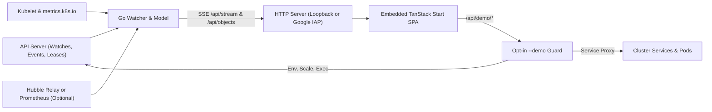

# visual-kubernetes

`visual-kubernetes` renders a live Kubernetes cluster as an airy, force-directed web on a single white page for teaching demos on non-production clusters. It runs as one stateless Deployment that is read-only by default, with an opt-in `--demo` mode for interactive workshops.

## Install

Install the default read-only Deployment in one command on any cluster that grants its ClusterRole (multi-arch `amd64` and `arm64` image). You reach the page through `kubectl port-forward`, and remove every resource with a single `kubectl delete -f`.

1. Apply the manifest, wait for rollout, and forward port `8080`:

   ```bash
   kubectl apply -f https://github.com/kesokaj/visual-kubernetes/releases/latest/download/install.yaml
   kubectl -n visual-kubernetes rollout status deploy/visual-kubernetes
   kubectl -n visual-kubernetes port-forward svc/visual-kubernetes 8080:80
   ```

2. Open `http://localhost:8080` in your browser.

To pin a specific release instead of `latest`, pass its version tag—for example, `https://github.com/kesokaj/visual-kubernetes/releases/download/v0.2.0/install.yaml` (release assets pin images by digest, while [`deploy/install.yaml`](deploy/install.yaml) in git pins the matching immutable tag).

The default manifest creates the `visual-kubernetes` namespace (Pod Security `restricted`), a read-only ClusterRole, one Deployment, a `ClusterIP` Service, and a deny-all-ingress `NetworkPolicy`. Where your CNI enforces `NetworkPolicy` (GKE Dataplane V2, Cilium, Calico, or `kind` kindnet), other pods cannot reach the app while `kubectl port-forward` still connects.

### Install variants

Choose the manifest that matches your cluster exposure and teaching mode; default installs never mutate cluster state.

| Manifest | Mode & exposure | Use when |
|---|---|---|
| [`deploy/install.yaml`](deploy/install.yaml) | Read-only · `visual-kubernetes` namespace · `ClusterIP` + deny-all `NetworkPolicy` | Default on any cluster (including GKE Autopilot) |
| [`deploy/install-kube-system.yaml`](deploy/install-kube-system.yaml) | Read-only · `kube-system` · `ClusterIP` + pod-scoped deny-all `NetworkPolicy` | Clusters where you prefer `kube-system` (not GKE Autopilot) |
| [`deploy/install-lb.yaml`](deploy/install-lb.yaml) | Read-only (`--logs=false`) · `LoadBalancer` + CIDR `NetworkPolicy` | Shared demo cluster behind client allowlists (`192.0.2.0/32` fails closed) |
| [`deploy/install-demo.yaml`](deploy/install-demo.yaml) | Interactive `--demo` (**non-production only**) · `ClusterIP` + `localhost` `Host` | Local or port-forwarded teaching demos with interactive controls |
| [`deploy/install-iap.yaml`](deploy/install-iap.yaml) | Interactive `--demo` + Google IAP (**non-production only**) · GKE NEG `ClusterIP` | GKE teaching cluster behind an External HTTPS Load Balancer + IAP |

<details>
<summary>Customize placeholders or side-load a local source build onto kind</summary>

- **Replace fail-closed placeholders:** On [`deploy/install-lb.yaml`](deploy/install-lb.yaml), replace `192.0.2.0/32` with your client CIDR(s) (`sed -i.bak 's|192.0.2.0/32|<YOUR_IP>/32|g' deploy/install-lb.yaml`). On [`deploy/install-iap.yaml`](deploy/install-iap.yaml), set your numeric GCP Project Number and BackendService ID in `--iap-audience`, and your HTTPS Load Balancer hostname in `--allowed-host`.
- **Side-load onto `kind`:** Build the frontend and container image, load it into `kind`, and switch the Deployment image:

  ```bash
  docker build -t visual-kubernetes:dev .
  kind load docker-image visual-kubernetes:dev --name visual-kubernetes
  kubectl apply -f deploy/install.yaml   # or deploy/install-demo.yaml on a non-production demo cluster
  kubectl -n visual-kubernetes set image deploy/visual-kubernetes visual-kubernetes=visual-kubernetes:dev
  ```

</details>

> [!WARNING]
> **LoadBalancer exposure (`install-lb.yaml`):** The UI has **no authentication**, so anyone inside `loadBalancerSourceRanges` can read every watched object (Secrets are excluded; the single named `hubble-relay-client-certs` Secret is never served by `/api/objects`). Never set `0.0.0.0/0` or `::/0`. `externalTrafficPolicy: Local` pairs with the `visual-kubernetes-lb-ingress` `NetworkPolicy` where supported; if your cloud LoadBalancer SNATs traffic or probes port `8080` directly, add its proxy or health-check CIDR under `spec.ingress[0].from`.

### Uninstall

Every manifest creates only stateless core objects (`Namespace`, `ServiceAccount`, `ClusterRole`, `ClusterRoleBinding`, `Deployment`, `Service`, `NetworkPolicy`) with `app.kubernetes.io/name: visual-kubernetes` and zero finalizers, PVCs, CRDs, or webhooks. Delete an install with the same manifest you applied:

```bash
kubectl delete --ignore-not-found -f https://github.com/kesokaj/visual-kubernetes/releases/latest/download/install.yaml
# or from a local checkout:
kubectl delete --ignore-not-found -f deploy/install.yaml
```

When switching between variants (for example, `install-demo.yaml` back to `install.yaml`), delete the previous manifest first so wider RBAC rules or ingress policies are removed cleanly.

## Quick start (development)

You can build, test, and run `visual-kubernetes` locally against a recorded stream without a Kubernetes cluster, or against a `kind` cluster on Colima. All setup and test commands match [`AGENTS.md`](AGENTS.md).

1. Enable `pnpm`, install frontend packages, build the embedded UI, and run Go checks:

   ```bash
   corepack enable pnpm                     # Node >= 22 (Node 26 needs: npm i -g corepack)
   pnpm -C web install
   pnpm -C web build && go build ./...
   go vet ./... && go test -race ./...
   ```

2. Run offline Playwright e2e tests or start the UI from a recorded stream:

   ```bash
   pnpm -C web exec playwright install --only-shell chromium   # once
   pnpm -C web exec playwright test
   go run ./cmd/visual-kubernetes --replay test/fixtures/streams/deploy-scale.ndjson
   ```

3. Explore ready-to-run teaching scenarios (`01-deployment`, `02-nodes`, `03-hpa`, `03b-vpa`, `04-traffic`) in [`examples/README.md`](examples/README.md), and see `fyr record get GUIDE-testing` for all test tiers.

## Architecture

One Go binary watches the cluster with `client-go` informers, merges optional kubelet/metrics/Hubble telemetry into an in-memory graph, and streams deltas over Server-Sent Events (`/api/stream`) to an embedded TanStack Start SPA. The visual layout follows [`design/mockup-v3.html`](design/mockup-v3.html): SVG bubbles and edges positioned by `d3-force`, paired with a Canvas 2D particle overlay for live traffic.



<details>
<summary>Repository layout (7 top-level directories)</summary>

```text
cmd/visual-kubernetes/  # Binary entrypoint: serve (live or --replay), probe, embedded ui/dist
internal/               # Cluster watch, model, SSE stream, probe, kubelet, hubble, iapauth, demo
web/                    # TanStack Start SPA (pnpm, Tailwind, d3-force) built into the binary
examples/               # Teaching scenarios and driver scripts
test/                   # NDJSON fixtures, fixturegen, Playwright e2e, kind scripts
design/                 # Approved visual reference (mockup-v3.html)
deploy/                 # Five install manifests and Go invariant tests
```

</details>

## Using the page

Navigate the cluster web with direct clicks, pointer pan/zoom, the compact bottom-left filter pill, and single-key presenter shortcuts.

<details>
<summary>Page controls and keyboard shortcuts (13 actions)</summary>

| Action | Effect |
|---|---|
| Click a bubble | Opens its detail panel and fades objects outside its neighbourhood |
| Hover a bubble | Temporarily fades everything outside its app, pods, satellites, and linked peers |
| `Esc`, `×`, or empty click | Closes the panel and hides the replay caption |
| Drag a bubble | Pins or rearranges it while the rest of the web settles around it (API hub stays centred) |
| Wheel, pinch, or empty drag | Zooms and pans manually (stops auto-fit) |
| `+` / `−` | Zooms in or out around the centre |
| Double-click | Zooms onto a bubble or into empty space |
| `F` or **Fit** | Fits the whole web in view and resumes auto-fit |
| Filter pill | Toggles 8 component groups, `visual-kubernetes` self-visibility, `Highlight` / `Only show` filters, and `Size by` |
| `V` | Hides or shows the filter pill |
| `R` | Replays the newest causal chain received since opening (1 step/s) |
| `Space` | Pauses or resumes replay |
| `→` | Advances replay by one step |

</details>

### Interactive `--demo` controls (non-production only)

When started with `--demo` (via [`deploy/install-demo.yaml`](deploy/install-demo.yaml) or [`deploy/install-iap.yaml`](deploy/install-iap.yaml)), the click panel adds live teaching controls gated by namespace protection (`kube-system`, `kube-public`, `kube-node-lease`, `visual-kubernetes`, `gke-managed-*`, `gmp-*`, and `core/Service/default/kubernetes` stay read-only).

| Control | Panel location | Capability |
|---|---|---|
| **Exposed ports · demo proxy** | Exposed apps, Services, `ext/internet` | Starts closed (`403`); mints a revocable token to preview a Service inside a sandboxed `<iframe>` |
| **Service exposure · type** | `Service` panels and satellites | Toggles `ClusterIP` ↔ `LoadBalancer` with `409` conflict checks and auto-revokes proxy sheets on revert |
| **Environment · demo editor** | `Deployment`, `StatefulSet`, `DaemonSet` | Edits plain container `env` entries (`valueFrom` secrets/ConfigMaps remain locked read-only) |
| **Workload scaling · replicas** | `Deployment`, `StatefulSet` | Steps `spec.replicas` (`0..50`, optimistic `409` reload; warns if HPA-managed; `DaemonSet` read-only) |
| **Autoscaling** | `HPA` and `VPA` satellites | Tunes HPA `minReplicas`/`maxReplicas` (`1..50`) or VPA `updateMode` and container `maxAllowed` |
| **Pod terminal** | Running `Pod`, app, `Service`, `Node` | Embedded `@xterm/xterm` shell over `/api/demo/exec` (refuses host-sharing (`hostNetwork`/`hostPID`/`hostIPC`/`hostPath`) or privileged pods) |

> [!WARNING]
> Pod logs contain application output that may hold tokens or passwords. Because `--logs=true` is the default in `install.yaml`, `install-kube-system.yaml`, `install-demo.yaml`, and `install-iap.yaml`, anyone who can open the UI can read the last 200 log lines per pod—keep ClusterIP installs behind `kubectl port-forward` or Google IAP, and keep `--logs=false` on `install-lb.yaml`.

<details>
<summary>Detail panel views and visual encodings (panel tabs & 6 canvas signals)</summary>

- **App and pod panels:** Summary, 90 s metrics sparklines (network, CPU, memory), Events (`events.k8s.io`, never Secrets), last 200 log lines from `/api/logs` (`403` `"Pod logs are off on this install."` when `--logs=false`), and live YAML from `/api/objects`.
- **Node, API server, control plane, and internet panels:** Node conditions and Events; `visual-kubernetes probe` source states on the API server; inferred `cp/*` evidence and folded static pods; entrypoint list on `ext/internet`.
- **Size & halo:** By default (`Size by: Auto`), app icons scale by network throughput, then CPU, then pod count (overridable via `Size by`); the top three apps receive a halo.
- **Pulse & travel:** Rings pulse on app/pod changes; newly scheduled pods animate along their node thread to their app.
- **Traffic & counters:** Hubble Relay or Prometheus flows draw blue forwarded particles and red drop particles/`×` marks routed through matching `Service` nodes; corner counters summarize folded or over-budget (> 150) items.

</details>

## Configuration

`visual-kubernetes` reads no config file or custom environment variables; all runtime behaviour is controlled by CLI flags and the `probe` subcommand.

| Flag / command | Default | Purpose |
|---|---|---|
| `--kubeconfig PATH` | In-cluster, else standard rules | Path to a kubeconfig file for local runs |
| `--addr ADDR` | `127.0.0.1:8080` local, `:8080` in-cluster | HTTP listen address |
| `--replay FILE` | `""` | Serve a recorded NDJSON stream without contacting a cluster |
| `--logs` | `true` | Serve pod logs on `/api/logs` (`--logs=false` returns `403`, used by `install-lb.yaml`) |
| `--demo` | `false` | Enable `/api/demo/*` endpoints on non-production clusters (loopback `Host` unless IAP is set) |
| `--allowed-host HOSTS` | `""` | Comma-separated DNS `Host` names permitted alongside `localhost` and IP literals |
| `--iap-audience AUD` | `""` | Google IAP JWT audience (`/projects/<PROJECT_NUMBER>/...`), requiring `--allowed-host` |
| `probe [--kubeconfig PATH]` | — | Print `<source> ok\|missing\|denied\|unreachable\|error <detail>` for every source |

## Deploy and project records

Local and GCP deployment runbooks live in the `DEPLOY-local` and `DEPLOY-gcp` records (`fyr record get DEPLOY-local`), and releases go through `/fyr-preflight`. Architecture decisions, changes, bug prevention rules, and session handoffs live in `fyr`'s record store (`fyr record list --kind adr`, `--kind change`, `--kind bug`, `--kind handoff`).
