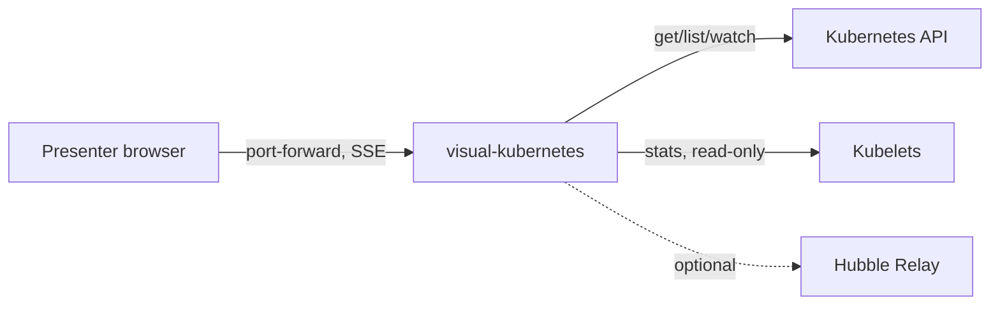
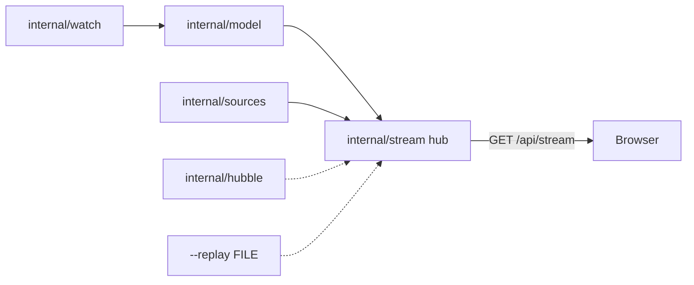

# SDD — visual-kubernetes

One Go binary watches a non-production teaching cluster read-only by default (with opt-in `--demo` mode for controlled Service proxying, workload `env` editing, and pod `exec`, plus optional Google IAP verification, ADR-010/ADR-011) and streams a live model to a browser page that draws it as a moving web.
Status: approved · Last updated: 2026-11-12 · Requirements: [PRD.md](PRD.md) · Technical design: [TDD.md](TDD.md)

<!-- The system design: the parts, their boundaries, the main flows and the big decisions — a summary a human reads
     in ten minutes. The detail lives in the records it links (an ADR per decision, a SPEC per surface), never
     restated here. Components are M1… (module); each satisfies PRD requirements by ID; TDD.md has one section per
     component. Kept current by the session that changes the design, in the same commit. -->

## Context

The presenter opens the page through `kubectl port-forward`, through an external IP limited by operator-set source ranges with pod logs off (`deploy/install-lb.yaml`, R7, ADR-008), or behind Google Identity-Aware Proxy on GKE (`deploy/install-iap.yaml`, ADR-011). The binary reads the Kubernetes API and kubelets. Hubble Relay and Prometheus flow metrics are optional and auto-detected. Nothing else is in scope: no cluster provisioning; default installs make no cluster writes (opt-in `--demo` adds plain container `env` updates and `pods/exec` strictly on non-production teaching clusters, ADR-010).

## Components

All v1 components of `PLAN-2026-11-09-1906-plan-visual-kubernetes-v1-live-spider-web-visual` are built: `cmd/visual-kubernetes probe`, `internal/kubelet`, `internal/probe` (Phase 0), `internal/watch`, `internal/model` (Phase 1), the serve command, `internal/sources`, `internal/stream` (Phase 2), the page shell in `web/` embedded by `cmd/visual-kubernetes/embed.go` (Phase 3), the click panel, encodings, folding and perf probe (Phase 4), teaching replay in `internal/replay` and `web/src/replay/`, the G3-scale perf probe and `examples/` (Phase 5), Hubble Relay + Prometheus pull traffic flows in `internal/hubble` and the Canvas 2D particle overlay in `web/src/web/TrafficCanvas.tsx` (Phase 6), and `deploy/{install,install-kube-system,install-lb}.yaml`, `--logs=false`, live causal-chain wiring in `cmd/visual-kubernetes/serve.go`, the multi-arch `Dockerfile`, and live kind e2e `test/e2e/live.sh` (Phase 7).

| ID | Component | Responsibility | Satisfies |
|---|---|---|---|
| M1 | `cmd/visual-kubernetes` + `internal/watch`, `internal/model`, `internal/sources` | Watch the cluster read-only, read metrics sources, keep the live model | R1, R2, R4, R8, S2, S4 |
| M2 | `internal/stream`, `internal/replay` | Serve SSE deltas with resume, decode recordings, the object/log endpoints (`--logs=false` 403 gate) and live + recorded causal chains | R5, R7 |
| M3 | `web/` | The embedded spider-web page (white grid paper, label-aware spacing, self-hide, group & focus filters), click panel, teaching replay and traffic particles | R5, R6, R7, R9, R10, S3, S5 |
| M4 | `internal/hubble` | Auto-detected Hubble Relay gRPC stream (Cilium plaintext, GKE DPv2 mTLS) + Prometheus pull fallback → per-edge `flow` SSE events | R1, R2, R4, S3 |
| M5 | `deploy/`, `Dockerfile`, `examples/` | One-command default install (`install.yaml`), `kube-system` variant (`install-kube-system.yaml`), opt-in LoadBalancer variant (`install-lb.yaml`, ADR-008), opt-in non-production demo variants (`install-demo.yaml`, `install-iap.yaml`, ADR-010, ADR-011), clean one-command `kubectl delete -f` uninstall across all five manifests, demo scenarios, local binary run | R1, R2, R3, R7, S1, S6, S7 |
| M6 | `internal/demo`, `internal/iapauth`, `web/src/demo/` | Opt-in `--demo` guards (`LoopbackOrIAP`, `SameOrigin`, protected namespaces), Google IAP JWT verification (`--iap-audience` via `google.golang.org/api/idtoken` + `--allowed-host`), presenter-gated capability-token Service HTTP proxy (`/api/demo/ports`, `/api/demo/proxy/t/{token}/`) with sandboxed in-app browser sheet, workload plain `env` editor (`/api/demo/workloads/env`), and WebSocket pod `exec` terminal (`/api/demo/exec`, `@xterm/xterm`) | R1, R2, R4, R6, R7, R9, R10, S7 |

## Flows

Informers (`internal/watch`) hand batched object changes to `model.ApplyEvents`, whose deltas and Kubernetes `event`s (never stored) become SSE events in the `internal/stream` hub (15 min ring, `Last-Event-ID` resume, else a fresh snapshot). Every 5 s after sync, `internal/sources` reads `metrics.k8s.io`, kubelet Summary (in-cluster only), `/readyz`, `/metrics` and Leases, publishing `metrics`, `capabilities` and inferred `cp/*` upserts. `--replay FILE` feeds the same hub from a recorded stream instead.

The binary serves the embedded build at `/` (hash-pinned CSP, same origin only), where the browser keeps a `Graph` store, filters it into a scene (`visual-kubernetes` itself hidden by default, plus optional `Highlight` or `Only show` workload-kind and namespace focus), and lays it out with label-aware d3-force spacing around the pinned API hub over a subtle white grid-paper background (auto-fit at 16:9). Clicking opens the panel (`/api/objects`, `/api/logs`, metrics sparklines and Events); apps size by the server's `sizeBy` unless the pill's `Size by` switch pins network, CPU, memory or pods (PRD C3), pulse on change, and past 150 bubbles fold into corner counters. Each app draws a faint disc with tethers to its pods and satellites; hovering (transient) or selecting (sticky) a body fades everything outside its neighbourhood (`neighborhood.ts`, layout untouched). Presenters zoom with the wheel, pinch, `+`/`−` keys, double-click or the `− Fit +` buttons in the filter pill, and can drag any body except the pinned hub while d3-force rearranges the rest (dragging stops auto-fit).

`internal/replay` builds causal chains (`chain` SSE events: 4 derived steps at the API hub, then observed steps; wired in both `cmd/visual-kubernetes/serve.go` after initial sync and `test/fixturegen`) that the page replays at 1 step/s (`R`, `Space`, `→`, `Esc`). In-cluster `internal/hubble` auto-detects Cilium or GKE DPv2 Hubble Relay (or queries Prometheus when Relay is absent), aggregates forward-direction `FORWARDED` and `DROPPED` flows per edge every 1 s into `flow` SSE events, each with an optional `via` naming the Service the traffic was addressed to (`internal/hubble/via.go`: Hubble's `destination_service`, else the destination app's only Service or the one whose target port matches the flow's port; Prometheus never sets it), and `TrafficCanvas.tsx` draws blue particles and red policy-drop marks over the web, routed src → Service → dst (`flowPath.ts`) when the page draws that Service, directly otherwise. Hovering any object shows a screen-space card with its name and `Kind · namespace` (`hoverLabel.tsx`; PLAN-2026-11-12-0951). While at least one unfolded entrypoint exists (a `LoadBalancer` or `NodePort` Service, an Ingress or a Gateway), `internal/model` adds the synthetic entity `ext/internet` (kind `Internet`, group `ext`, filter group `ingress`) with a `routes` edge to each entrypoint, or to the app it merged into; Hubble endpoints with a `reserved:world*` identity and Prometheus sides named `world` or `reserved:world*` with no namespace resolve to it, so internet traffic is drawn from a globe (PLAN-2026-11-11-1703, D4/D10/D11). Teaching scenarios live in `examples/` (`01-deployment`, `02-nodes`, `03-hpa`, `03b-vpa`, `04-traffic`).

## Decisions

ADR-001 (PRD v1), ADR-002 (SSE, not WebSocket), ADR-003 (SVG + d3-force with Canvas particles), ADR-004 (force web, no hierarchy bands), ADR-005 (kubelet Summary on :10250 with `nodes/stats`), ADR-006 (kubelet client only in-cluster), ADR-007 (R8–R10 enforced by named tests), ADR-008 (opt-in LoadBalancer variant with required source ranges and logs off), ADR-009 (PRD R6 UI polish amendment and v1 enforcement trace), ADR-010 (opt-in `--demo` and `install-demo.yaml` keep default installs read-only), ADR-011 (loopback-only guard on `--demo` until Google IAP is configured). List them with `fyr record list --kind adr`; smaller choices are the plan's D-rows.

## Cross-cutting

- **Security:** default installs (`install.yaml`, `install-kube-system.yaml`, `install-lb.yaml`, `--demo=false`) use strictly read-only RBAC with no Secrets and answer `403` on `/api/demo/*`. The UI and `/api/objects`, `/api/logs` have no auth unless `--iap-audience` is set, so the default Service is ClusterIP and is reached only through port-forward. The opt-in LoadBalancer variant (`deploy/install-lb.yaml`, ADR-008) ships fail-closed `loadBalancerSourceRanges` (`192.0.2.0/32`) that the operator replaces with their client CIDR(s) and runs with `--logs=false`. When `--iap-audience` and `--allowed-host` are set (`deploy/install-iap.yaml`, ADR-011), `internal/iapauth` verifies `x-goog-iap-jwt-assertion` on every `/` and `/api/*` request through `google.golang.org/api/idtoken` with `Issuer == "https://cloud.google.com/iap"` (`401` on failure, raw tokens never logged, `X-Goog-Authenticated-User-Email` never trusted, `GET /healthz` exempted only on literal pod-IP `Host` headers). When opt-in `--demo` (non-production teaching clusters only, `deploy/install-demo.yaml` and `deploy/install-iap.yaml`, ADR-010/ADR-011) is enabled without `--iap-audience`, `LoopbackOrIAP` refuses non-loopback `Host` headers on every non-`/healthz` route; `SameOrigin` guards `POST /api/demo/ports`, `PATCH /api/demo/workloads/env` and the `/api/demo/exec` WebSocket handshake; system namespaces and selectorless Services are refused (`403`); `/api/demo/workloads/env` updates only plain `name`/`value` container variables (`409` on stale `resourceVersion`, preserving `valueFrom` entries read-only without reading Secrets, `R2`); `/api/demo/exec` restricts shells to `/bin/sh` or `/bin/bash` on running non-system, non-`hostNetwork` pods (`403` otherwise) with a 4-session cap (`429`) and `10m` frame-activity idle / `30m` max lifetime; in-cluster proxy targets resolve ready non-`hostNetwork` selector-matched Pod `IP:targetPort` directly while `SafeDialer` blocks loopback/link-local/metadata/API-server/Node IPs and kubelet `:10250`/`:10255` ports; and proxied HTML is isolated inside `Content-Security-Policy: sandbox allow-scripts allow-forms` with `Set-Cookie` and outbound presenter credentials stripped. Kubelet TLS is always verified.
- **Observability:** JSON `log/slog` to stderr; nothing else yet.
- **Cost:** one small pod in the cluster; the image is public in Artifact Registry (egress is billed to `exact-loon-6dim`).

## Deployment

One Deployment plus a ClusterRole, applied with one `kubectl apply -f install.yaml` (the release assets pin the image by digest) and cleanly removed with one `kubectl delete --ignore-not-found -f <manifest>` (stateless kinds only, `Namespace` ordered first, zero finalizers, pinned across all five manifests in `deploy/uninstall_test.go`). Default `deploy/install.yaml` creates the `visual-kubernetes` namespace (`restricted` PSA), a ClusterIP Service and a NetworkPolicy denying all ingress, so only `kubectl port-forward` reaches the unauthenticated page (enforced where the CNI implements NetworkPolicy). `deploy/install-kube-system.yaml` places the same ClusterIP install in `kube-system` with a pod-scoped deny-all-ingress NetworkPolicy and no Namespace mutation (PRD S1); `deploy/install-lb.yaml` provides the opt-in LoadBalancer variant with required non-public `loadBalancerSourceRanges`, `--logs=false` and a TCP `8080` ingress NetworkPolicy (PRD R7, ADR-008); `deploy/install-demo.yaml` enables `--demo` behind ClusterIP + deny-all-ingress NetworkPolicy for non-production clusters via `kubectl port-forward` (ADR-010); and `deploy/install-iap.yaml` pairs `--demo` with `--iap-audience` + `--allowed-host`, a GKE NEG ClusterIP Service, and an `ipBlock` TCP `http` NetworkPolicy restricted to Google Cloud HTTPS Load Balancer / IAP proxy CIDRs (`35.191.0.0/16`, `130.211.0.0/22`, ADR-011). The procedures are `DEPLOY-local` and `DEPLOY-gcp`.

## Risks

- Managed control planes hide their pods, so control-plane parts must be inferred (Leases, `/readyz`, metrics). Shows up as empty control-plane bubbles on GKE.
- Large clusters (more than 20 nodes or 500 pods) may overload the page. Shows up as a frame rate below 30 fps in the Playwright perf check.

## Trace

Requirement-to-component trace (17 requirements)

| Requirement | Components |
|---|---|
| R1 | M1, M4, M5, M6 |
| R2 | M1, M4, M5, M6 |
| R3 | M5 |
| R4 | M1, M4, M6 |
| R5 | M2, M3 |
| R6 | M3, M6 |
| R7 | M2, M3, M5, M6 |
| R8 | M1 |
| R9 | M3, M6 |
| R10 | M3, M6 |
| S1 | M5 |
| S2 | M1 |
| S3 | M4 |
| S4 | M1 |
| S5 | M3 |
| S6 | M5 |
| S7 | M5, M6 |

