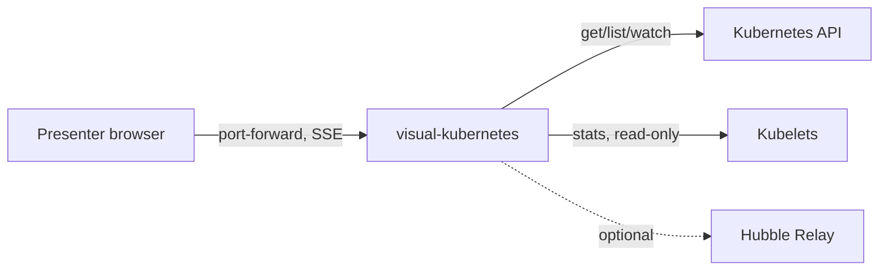
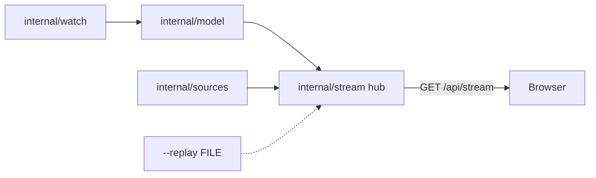

# SDD — visual-kubernetes

One Go binary watches the cluster read-only and streams a live model to a browser page that draws it as a moving web.
Status: draft · Last updated: 2026-11-10 · Requirements: [PRD.md](PRD.md) · Technical design: [TDD.md](TDD.md)

<!-- The system design: the parts, their boundaries, the main flows and the big decisions — a summary a human reads
     in ten minutes. The detail lives in the records it links (an ADR per decision, a SPEC per surface), never
     restated here. Components are M1… (module); each satisfies PRD requirements by ID; TDD.md has one section per
     component. Kept current by the session that changes the design, in the same commit. -->

## Context

The presenter opens the page through `kubectl port-forward`. The binary reads the Kubernetes API and kubelets. Hubble Relay and OTel are optional and auto-detected. Nothing else is in scope: no cluster provisioning, no writes.

## Components

Built so far: `cmd/visual-kubernetes probe`, `internal/kubelet`, `internal/probe` (Phase 0), `internal/watch`, `internal/model` (Phase 1), and the serve command, `internal/sources`, `internal/stream` (Phase 2), and the page shell in `web/` embedded by `cmd/visual-kubernetes/embed.go` (Phase 3). The rest is planned in PLAN-2026-11-09-1906-plan-visual-kubernetes-v1-live-spider-web-visual.

| ID | Component | Responsibility | Satisfies |
|---|---|---|---|
| M1 | `cmd/visual-kubernetes` + `internal/watch`, `internal/model`, `internal/sources` | Watch the cluster read-only, read metrics sources, keep the live model | R1, R2, R4, R8, S2, S4 |
| M2 | `internal/stream` (replay included; causal chains planned) | Serve SSE deltas with resume, the object/log endpoints and causal chains | R5 |
| M3 | `web/` (spider web and filter pill built; click panel and replay keys planned) | The embedded spider-web page, filter pill, click panel, replay keys | R5, R6, R9, R10, S5 |
| M4 | `internal/hubble` (planned) | Optional Hubble Relay flows | S3 |
| M5 | `deploy/`, `Dockerfile`, `examples/` (planned) | One-command install, ClusterIP access, demo scenarios, local binary run | R3, R7, S1, S6, S7 |

## Flows

Built: cluster watch → model → hub → SSE. Informers (`internal/watch`) hand batched object changes to `model.Apply`, whose deltas become SSE events in the `internal/stream` hub (15 min ring, `Last-Event-ID` resume, else a fresh snapshot). Every 5 s, once the informers have synced, the `internal/sources` collector reads metrics.k8s.io, kubelet Summary (in-cluster only), `/readyz`, `/metrics` and Leases, and publishes `metrics`, `capabilities` and inferred `cp/*` upserts into the same hub. `--replay FILE` feeds the hub from a recorded stream instead. Built in Phase 3: hub → page. The binary serves the embedded build at `/` (hash-pinned CSP, same origin only); the page opens `/api/stream`, keeps a `Graph` store, filters it into a scene, lays it out with d3-force around the pinned API hub and auto-fits it at 16:9.

## Decisions

ADR-001 (PRD v1), ADR-002 (SSE, not WebSocket), ADR-003 (SVG + d3-force with Canvas particles), ADR-004 (force web, no hierarchy bands), ADR-005 (kubelet Summary on :10250 with `nodes/stats`), ADR-006 (kubelet client only in-cluster). List them with `fyr record list --kind adr`; smaller choices are the plan's D-rows.

## Cross-cutting

- **Security:** read-only RBAC with no Secrets. The UI and `/api/objects`, `/api/logs` have no auth, so the Service is ClusterIP and is reached only through port-forward; run locally the server binds 127.0.0.1 by default (plan D26), and a Host allowlist (IP literals, `localhost`, the `--addr` name) stops DNS rebinding through the presenter's browser. Kubelet TLS is always verified.
- **Observability:** JSON `log/slog` to stderr; nothing else yet.
- **Cost:** one small pod in the cluster; the image is public in Artifact Registry (egress is billed to `exact-loon-6dim`).

## Deployment

One Deployment plus a ClusterRole, applied with one `kubectl apply -f install.yaml`. The procedures are `DEPLOY-local` and `DEPLOY-gcp`.

## Risks

- Managed control planes hide their pods, so control-plane parts must be inferred (Leases, `/readyz`, metrics). Shows up as empty control-plane bubbles on GKE.
- Large clusters (more than 20 nodes or 500 pods) may overload the page. Shows up as a frame rate below 30 fps in the Playwright perf check.

## Trace

| Requirement | Components |
|---|---|
| R1 | M1, M5 |
| R2 | M1, M5 |
| R3 | M5 |
| R4 | M1 |
| R5 | M2, M3 |
| R6 | M3 |
| R7 | M5 |
| R8 | M1 |
| R9 | M3 |
| R10 | M3 |
| S1 | M5 |
| S2 | M1 |
| S3 | M4 |
| S4 | M1 |
| S5 | M3 |
| S6 | M5 |
| S7 | M5 |
