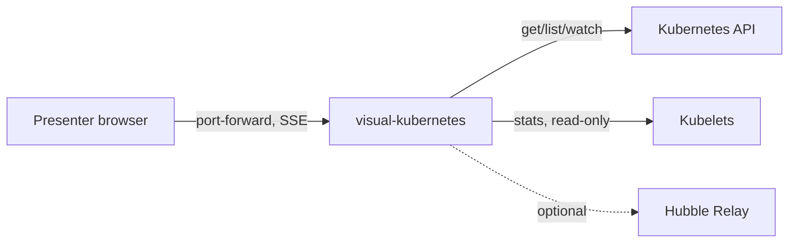

# SDD — visual-kubernetes

One Go binary watches the cluster read-only and streams a live model to a browser page that draws it as a moving web.
Status: draft · Last updated: 2026-11-09 · Requirements: [PRD.md](PRD.md) · Technical design: [TDD.md](TDD.md)

<!-- The system design: the parts, their boundaries, the main flows and the big decisions — a summary a human reads
     in ten minutes. The detail lives in the records it links (an ADR per decision, a SPEC per surface), never
     restated here. Components are M1… (module); each satisfies PRD requirements by ID; TDD.md has one section per
     component. Kept current by the session that changes the design, in the same commit. -->

## Context

The presenter opens the page through `kubectl port-forward`. The binary reads the Kubernetes API and kubelets. Hubble Relay and OTel are optional and auto-detected. Nothing else is in scope: no cluster provisioning, no writes.

## Components

No code yet. The first component the plan builds is listed below; the rest land with the plan record.

| ID | Component | Responsibility | Satisfies |
|---|---|---|---|
| M1 | `cmd/visual-kubernetes` (planned) | Watch the cluster read-only, keep the live model, serve the embedded UI and an SSE stream | — |

## Flows

No flows are implemented yet. The first flow will be cluster watch → model → SSE → page, drawn here when it exists.

## Decisions

No ADRs yet. The candidates the plan will record: SSE over WebSocket, SVG plus d3-force plus Canvas particles, and a force "spider web" layout instead of hierarchy bands (operator, 2026-11-09).

## Cross-cutting

- **Security:** read-only RBAC with no Secrets. The UI has no auth, so the Service is ClusterIP and is reached only through port-forward. Kubelet TLS is always verified.
- **Observability:** JSON `log/slog` to stdout; nothing else yet.
- **Cost:** one small pod in the cluster; the image is public in Artifact Registry (egress is billed to `exact-loon-6dim`).

## Deployment

One Deployment plus a ClusterRole, applied with one `kubectl apply -f install.yaml`. The procedures are `DEPLOY-local` and `DEPLOY-gcp`.

## Risks

- Managed control planes hide their pods, so control-plane parts must be inferred (Leases, `/readyz`, metrics). Shows up as empty control-plane bubbles on GKE.
- Large clusters (more than 20 nodes or 500 pods) may overload the page. Shows up as a frame rate below 30 fps in the Playwright perf check.

## Trace

PRD.md has no requirement items yet (`/fyr-requirements` elicits them); rows land with them.

| Requirement | Components |
|---|---|
| — | — |
