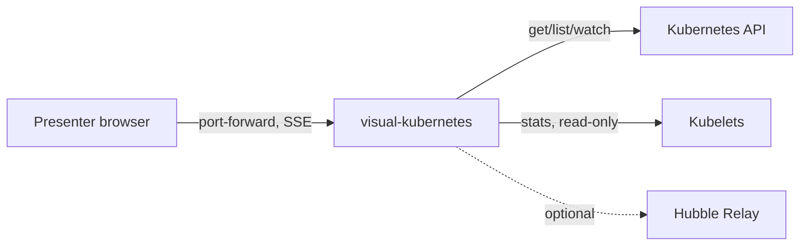
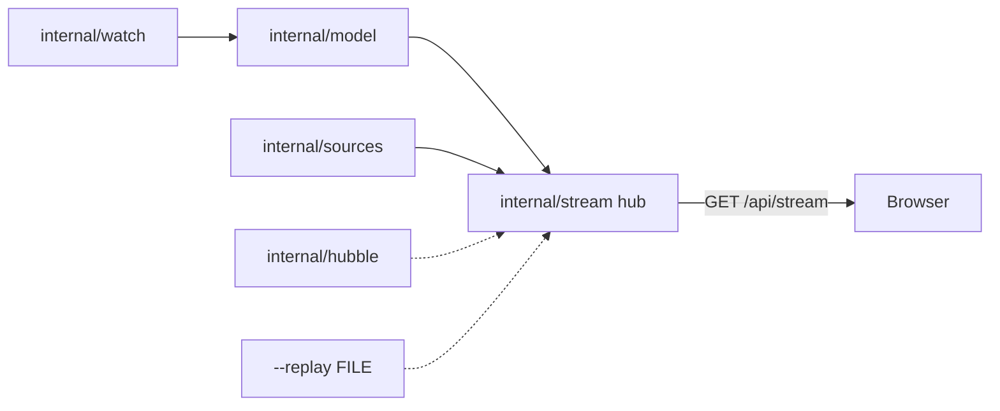

# SDD — visual-kubernetes

One Go binary watches the cluster read-only and streams a live model to a browser page that draws it as a moving web.
Status: draft · Last updated: 2026-11-11 · Requirements: [PRD.md](PRD.md) · Technical design: [TDD.md](TDD.md)

<!-- The system design: the parts, their boundaries, the main flows and the big decisions — a summary a human reads
     in ten minutes. The detail lives in the records it links (an ADR per decision, a SPEC per surface), never
     restated here. Components are M1… (module); each satisfies PRD requirements by ID; TDD.md has one section per
     component. Kept current by the session that changes the design, in the same commit. -->

## Context

The presenter opens the page through `kubectl port-forward`, or, with the opt-in LoadBalancer variant planned in Phase 7, through an external IP limited by source ranges (R7, ADR-008). The binary reads the Kubernetes API and kubelets. Hubble Relay and OTel are optional and auto-detected. Nothing else is in scope: no cluster provisioning, no writes.

## Components

Built so far: `cmd/visual-kubernetes probe`, `internal/kubelet`, `internal/probe` (Phase 0), `internal/watch`, `internal/model` (Phase 1), the serve command, `internal/sources`, `internal/stream` (Phase 2), the page shell in `web/` embedded by `cmd/visual-kubernetes/embed.go` (Phase 3), the click panel, encodings, folding and perf probe (Phase 4), teaching replay in `internal/replay` and `web/src/replay/`, the G3-scale perf probe and `examples/` (Phase 5), Hubble Relay + Prometheus pull traffic flows in `internal/hubble` and the Canvas 2D particle overlay in `web/src/web/TrafficCanvas.tsx` (Phase 6), and `deploy/install.yaml` with the multi-arch `Dockerfile` (Phase 7, release v0.1.0). The rest is planned in PLAN-2026-11-09-1906-plan-visual-kubernetes-v1-live-spider-web-visual.

| ID | Component | Responsibility | Satisfies |
|---|---|---|---|
| M1 | `cmd/visual-kubernetes` + `internal/watch`, `internal/model`, `internal/sources` | Watch the cluster read-only, read metrics sources, keep the live model | R1, R2, R4, R8, S2, S4 |
| M2 | `internal/stream`, `internal/replay` | Serve SSE deltas with resume, decode recordings, the object/log endpoints and causal chains (builder runs in fixturegen; live wiring deferred D48) | R5 |
| M3 | `web/` (spider web, filter pill, click panel, encodings, folding, teaching replay and Canvas 2D traffic overlay built) | The embedded spider-web page, filter pill, click panel, teaching replay and traffic particles | R5, R6, R9, R10, S3, S5 |
| M4 | `internal/hubble` | Auto-detected Hubble Relay gRPC stream (Cilium plaintext, GKE DPv2 mTLS) + Prometheus pull fallback → per-edge `flow` SSE events | R1, R2, R4, S3 |
| M5 | `deploy/`, `Dockerfile`, `examples/` (`install.yaml`, `Dockerfile` and `examples/` built; the kube-system and LoadBalancer variants planned in Phase 7) | One-command install, ClusterIP access by default and an opt-in LoadBalancer variant (ADR-008), demo scenarios, local binary run | R3, R7, S1, S6, S7 |

## Flows

Informers (`internal/watch`) hand batched object changes to `model.ApplyEvents`, whose deltas and Kubernetes `event`s (never stored) become SSE events in the `internal/stream` hub (15 min ring, `Last-Event-ID` resume, else a fresh snapshot). Every 5 s after sync, `internal/sources` reads `metrics.k8s.io`, kubelet Summary (in-cluster only), `/readyz`, `/metrics` and Leases, publishing `metrics`, `capabilities` and inferred `cp/*` upserts. `--replay FILE` feeds the same hub from a recorded stream instead.

The binary serves the embedded build at `/` (hash-pinned CSP, same origin only), where the browser keeps a `Graph` store, filters it into a scene, and lays it out with d3-force around the pinned API hub (auto-fit at 16:9). Clicking opens the panel (`/api/objects`, `/api/logs`, metrics sparklines and Events); apps size by `sizeBy`, pulse on change, and past 150 bubbles fold into corner counters.

`internal/replay` builds causal chains (`chain` SSE events: 4 derived steps at the API hub, then observed steps; runs in `test/fixturegen`, live wiring deferred D48) that the page replays at 1 step/s (`R`, `Space`, `→`, `Esc`). In-cluster `internal/hubble` auto-detects Cilium or GKE DPv2 Hubble Relay (or queries Prometheus when Relay is absent), aggregates forward-direction `FORWARDED` and `DROPPED` flows per edge every 1 s into `flow` SSE events, and `TrafficCanvas.tsx` draws blue particles and red policy-drop marks over the web. Teaching scenarios live in `examples/` (`01-deployment`, `02-nodes`, `03-hpa`, `03b-vpa`, `04-traffic`).

## Decisions

ADR-001 (PRD v1), ADR-002 (SSE, not WebSocket), ADR-003 (SVG + d3-force with Canvas particles), ADR-004 (force web, no hierarchy bands), ADR-005 (kubelet Summary on :10250 with `nodes/stats`), ADR-006 (kubelet client only in-cluster), ADR-007 (R8–R10 enforced by named tests), ADR-008 (opt-in LoadBalancer variant with required source ranges and logs off). List them with `fyr record list --kind adr`; smaller choices are the plan's D-rows.

## Cross-cutting

- **Security:** read-only RBAC with no Secrets. The UI and `/api/objects`, `/api/logs` have no auth, so the default Service is ClusterIP and is reached only through port-forward. The opt-in LoadBalancer variant (Phase 7, ADR-008) requires `loadBalancerSourceRanges` and runs with `--logs=false`; anyone inside those ranges can read every object. Run locally, the server binds 127.0.0.1 by default (plan D26), and a Host allowlist (IP literals, `localhost`, the `--addr` name) stops DNS rebinding through the presenter's browser; an LB IP passes it as an IP literal (D39). Kubelet TLS is always verified.
- **Observability:** JSON `log/slog` to stderr; nothing else yet.
- **Cost:** one small pod in the cluster; the image is public in Artifact Registry (egress is billed to `exact-loon-6dim`).

## Deployment

One Deployment plus a ClusterRole, applied with one `kubectl apply -f install.yaml` (built; the release asset pins the image by digest). It also carries a ClusterIP Service and a NetworkPolicy denying all ingress, so only `kubectl port-forward` reaches the unauthenticated page; the policy is enforced only where the CNI implements NetworkPolicy. `install-lb.yaml`, the opt-in LoadBalancer variant (ADR-008), and the `kube-system` variant are planned in Phase 7. The procedures are `DEPLOY-local` and `DEPLOY-gcp`.

## Risks

- Managed control planes hide their pods, so control-plane parts must be inferred (Leases, `/readyz`, metrics). Shows up as empty control-plane bubbles on GKE.
- Large clusters (more than 20 nodes or 500 pods) may overload the page. Shows up as a frame rate below 30 fps in the Playwright perf check.

## Trace

| Requirement | Components |
|---|---|
| R1 | M1, M5 |
| R2 | M1, M5 |
| R3 | M5 |
| R4 | M1 |
| R5 | M2, M3 |
| R6 | M3 |
| R7 | M5 |
| R8 | M1 |
| R9 | M3 |
| R10 | M3 |
| S1 | M5 |
| S2 | M1 |
| S3 | M4 |
| S4 | M1 |
| S5 | M3 |
| S6 | M5 |
| S7 | M5 |
