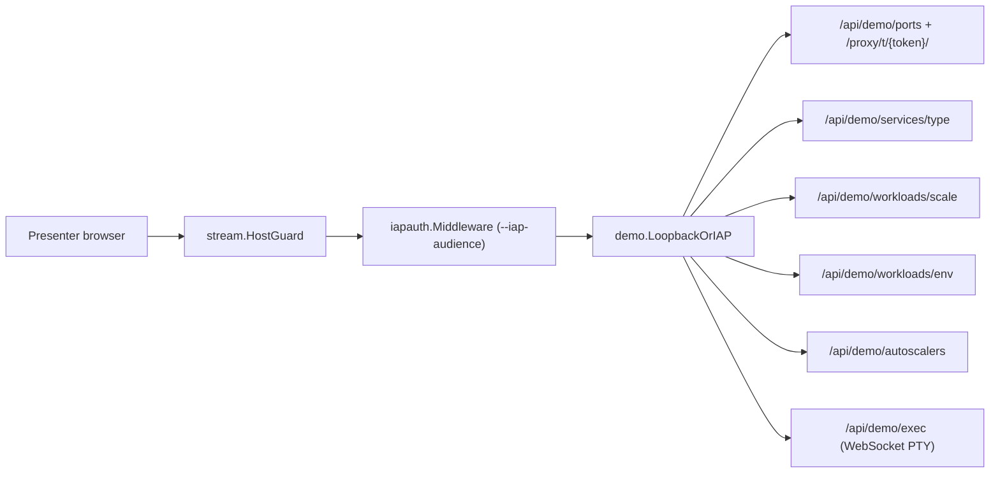

# TDD — visual-kubernetes

How each part of visual-kubernetes is built and tested.
Status: approved · Last updated: 2026-11-13 · Requirements: [PRD.md](PRD.md) · Design: [SDD.md](SDD.md)

<!-- The technical design: one section T1… per component M… of SDD.md — its interfaces, data, errors, configuration
     and dependencies — each a summary that points at the SPEC record holding the detail (`fyr record get SPEC-…`),
     never a copy of it. TODO.md tasks name the section they build (→ T1). Kept current by the session that
     changes the code, in the same commit. -->

## T1 — visual-kubernetes binary

Implements: M1 · Spec: none (wire contract in [SDD.md](SDD.md) and `PLAN-2026-11-09-1906-plan-visual-kubernetes-v1-live-spider-web-visual` § Interfaces)

- **Interfaces:** `visual-kubernetes [--kubeconfig PATH] [--addr HOST:PORT] [--replay FILE] [--logs=true|false] [--demo] [--allowed-host HOST[,HOST...]] [--iap-audience /projects/.../backendServices/...]` serves the stream (`--addr` defaults to `127.0.0.1:8080` with `--kubeconfig` or `--replay`, `:8080` in-cluster, plan D26; `--replay` with `--kubeconfig` is a usage error; `--logs` defaults to `true`, and `--logs=false` makes `/api/logs` answer `403`, plan D38, ADR-008; `--demo` defaults to `false` and enables `/api/demo/*` for non-production teaching clusters only, ADR-010, ADR-011; `--iap-audience` must start with `/projects/` and requires non-empty `--allowed-host`, exiting `1` otherwise). `visual-kubernetes probe [--kubeconfig PATH]` prints `<source> ok|missing|denied|unreachable|error <detail>` per source (`internal/probe`); exit 0 always, 1 when no client can be built, 2 on usage. The serve command embeds the page build (`cmd/visual-kubernetes/embed.go`, Phase 3).
- **Errors:** `probe.Classify` maps API and TLS errors to the five states, checking TLS errors first. A missing optional source degrades the view (a `capabilities` event names it) and never crashes the app.
- **Configuration:** in-cluster config, or `--kubeconfig` when run locally (`newClients` also keeps an untimed `execCfg = rest.CopyConfig(watchCfg)` so `15 s` `requestTimeout` never terminates `/api/demo/exec`, D8). The kubelet Summary client (`internal/kubelet`) is built only from in-cluster config, verifies TLS against the CA bundle and never follows redirects (ADR-005, ADR-006).
- **Watch (`internal/watch`):** discovery keeps the list+watch resources of the 13 RBAC groups (D16), minus Secrets and subresources; a `Limit: 1` list skips forbidden, gone or list-less kinds (one `kind skipped` warning each) while any other error keeps the informer retrying. Events are watched through one API, events.k8s.io/v1 when its list check passes, else core/v1 (D29). Each informer trims objects before caching them (`trimForCache`: managedFields, the last-applied annotation, core ConfigMap `data`/`binaryData`; Events keep only identity, regarding, type, reason, note/message (cut at 1024 bytes) and their times; an Event about a Secret is never streamed) and feeds one goroutine that hands batches of typed objects (CRD kinds stay unstructured) to the model; `Synced()` is the `/healthz` condition (readiness in `deploy/install.yaml`; liveness is a TCP check, so a slow sync never restarts the pod).
- **Model (`internal/model`):** `Apply` recomputes the drawable view and returns ordered deltas (entity upserts, edge upserts, edge deletes, entity deletes). Ids per D13 and D23 (`app/<ns>/<Kind>/<name>`, `cp/apiserver` hub, `counter/<group>.<Kind>`); apps by top controller owner, Services merged only over exactly one app (D15); HPA, VPA, ConfigMap, PVC, NetworkPolicy, Ingress, Gateway API become satellites (`appId`) or edges (`member`, `hosts`, `selects`, `references`, `routes`, `parent`); unreferenced and undrawn kinds are counted; past S5 (20 nodes, 500 pods, 150 apps) system apps then the smallest fold into `counter/folded.{apps,pods}`. Secrets and Events are never stored (R2): `ApplyEvents` returns `Apply`'s deltas plus one `event` per added or updated Event (`{k8sEvent:{id,type,reason,message,at}}`, `id` = the regarding object's entity id, `at` its newest time; D32), which the serve command publishes.
- **Sources (`internal/sources`):** a `Collector` runs every 5 s (plan D24). It reads metrics.k8s.io pod usage (Quantities summed per pod, rounded once), kubelet Summary network bytes turned into rates over a 10 s window (in-cluster only; hostNetwork pods and pods missing from the model are skipped, 8 nodes at a time, 4 s each), `/readyz?verbose=true` every cycle and the apiserver `/metrics` object counts every 6th. It infers `cp/apiserver`, `cp/etcd`, `cp/scheduler`, `cp/controller-manager` from readyz checks and Lease freshness, tagging each with the label `visual-kubernetes/evidence` = `lease|readyz|none` (S4). Cycles wait for the informers' first sync (`Deps.Ready`, latched open once true). It emits a `metrics` event whose `sizeBy` is `network`, else `cpu`, else `pods`, plus a `capabilities` event and `cp/*` upserts only when they change.

## T2 — stream and replay

Implements: M2 · Built in Phase 2 (`internal/stream`) and Phase 5 (`internal/replay`, chain decoding in `internal/stream/replay.go`). Event payloads come from `internal/model` (`model.SnapshotEvent`, `model.DeltaEvents`, `model.Record`; `edgeUpsert {edge}` and `edgeDelete {id}` added by plan D22; `event {k8sEvent}` from `model.ApplyEvents`, D32) and `internal/replay` (`chain` events, D17).

- **Hub:** keeps the current view plus a 15 min ring (capped) of numbered events. Ids start at the process start time in µs, so ids from an earlier process never resume by accident. `Subscribe` replays only the missed events when `Last-Event-ID` falls in `[oldest-1, last]`; any other id (absent, malformed, too old, foreign) gets a fresh `snapshot`. A subscriber whose buffer fills is dropped and reconnects with its last id.
- **HTTP:** `GET /api/stream` (SSE: `snapshot`, `upsert`, `delete`, `edgeUpsert`, `edgeDelete`, `metrics`, `capabilities`, `event`, `chain`, `flow`), `GET /healthz` (503 until the informers sync, latched 200 thereafter), `GET /api/objects?id=` (the object as YAML, model first, managedFields stripped, Secrets refused; 400 malformed id, 404 unknown) and `GET /api/logs?id=&container=&tailLines=` (default 200, capped at 1000 lines and 1 MiB; answers `403` `"logs are off on this install"` when `LogsDisabled` is set via `--logs=false`). Upstream errors map to 404/403/502 without the API detail; every response sets `nosniff`. `HostGuard` answers 403 unless the Host is an IP literal, `localhost`, the `--addr` name, or one of the `--allowed-host` hostnames (`extra ...string`), so a DNS-rebinding page cannot read the endpoints; when `--iap-audience` is set, `iapauth.NewMiddleware` wraps the handler below `HostGuard`.
- **Causal chains (`internal/replay`):** `Builder` (`New()/Prime()/Observe()`, plan D17) turns object changes into `chain` SSE events (`{id, steps:[{at, actor, verb, object, derived}]}`). The 4 derived steps (`authentication`, `authorization`, `admission`, `persisted`) come first, attributed to the newest managedFields manager (or fallback `"client"` in live mode where `internal/watch` trims `managedFields`), followed by observed steps (`created`/`updated`/`deleted`, `scheduled`/`failed scheduling`, `started`, `ready`, and EndpointSlice updates). Bounded to 16 chains, 64 steps per chain, 3 min TTL. Wired in `cmd/visual-kubernetes/serve.go` (`newChainSink`, priming initial-list batches and observing post-sync changes) and in `test/fixturegen`.
- **Replay:** `--replay FILE` validates a recorded `.ndjson` stream (snapshot first, state, `event`, `chain` and `flow` records decoded and validated, other plain-word events passed through), waits for the first subscriber, then plays it once on its `atMs` timing (plan D25); `/api/objects` returns the entity as YAML and `/api/logs` a note that replay has no logs.
- **Recorded streams:** `go run ./test/fixturegen` rewrites `test/fixtures/streams/{deploy-scale,large-cluster,missing-sources,node-join,g3-scale}.ndjson` (snapshot at `atMs` 0, then deltas, `event` records, and causal `chain`s for deploy-scale, large-cluster, and missing-sources; new `g3-scale.ndjson` carries hub, 4 nodes, 150 apps / 1,000 pods with 5 apps folded into overBudget for perf testing, plan D49) byte for byte, and `TestFixturesAreCurrent` fails on stale files.

## T3 — web page

The browser client turns the SSE stream into an external `Graph` store, projects it through group, self-visibility and focus filters into a bounded `Scene`, and renders a d3-force SVG web with a sleeping Canvas 2D traffic overlay.

Implements: M3 · Built in Phases 3 and 4: `web/` (TanStack Start SPA, pnpm, Tailwind), teaching replay in Phase 5 (`web/src/replay/`, `web/src/lib/chains.ts`).

```mermaid
flowchart LR
  sse["SSE /api/stream"] --> wire["wire.ts"] --> graph["Graph store"]
  filter["FilterPill + state.ts"] --> scene["buildScene"]
  graph --> scene --> layout["d3-force + camera"] --> svg["SVG web + GridPaper"]
  graph -.->|"flow events"| canvas["TrafficCanvas"]
```

- **Stream and state (`web/src/lib/`):** `wire.ts` parses SSE guardedly, dropping invalid items one by one; `graph.ts` is the external store (`capabilities` deltas merge by key; `flow` events update `flows.ts` without bumping `Graph.version`); `chains.ts` keeps the newest copy of each causal chain by id (max 16); `flows.ts` keeps active per-edge traffic (`FLOW_TTL_MS = 6.5 s`), bounded particles (`MAX_PARTICLES = 600`) and policy-drop marks (`DROP_MS = 1.2 s`); `telemetry.ts` keeps the latest metrics sample per id, 90 s of sparkline history, `sizeBy` (pods until the first `metrics` event, D33), `measureOf` for network, CPU and memory, and a bounded Event log; `motion.ts` derives pulses and pod travel from deltas.
- **Force web (`web/src/web/`):** `scene.ts` projects the filtered graph into anchors (with label-aware `collideR` clearance and `dimmed` focus state) and links, hiding `visual-kubernetes` itself by default before `sizing.ts` ranks app areas and top-3 halos (S2, plan D54). `folding.ts` folds static control-plane pods behind their `cp/*` entity (D30, D34), and `Counters.tsx` shows `counter/*` entities plus `counter/page.overBudget` past 150 bubbles (D33). `layout.ts` runs d3-force around the pinned hub (reheating only on structural change, D36) over `marks.tsx`'s world-synced `#vk-grid` paper, while `camera.ts` and `panzoom.ts` manage 16:9 auto-fit, pan/zoom (wheel, pinch, `+`/`−`, double-click, `zoomTo`/`glide` toward a target, ZOOM_MAX 6) and body drag (`layout.drag`/`release` reheat the simulation; the hub is never grabbed), `neighborhood.ts` computes the hover/selection neighbourhood that `Web.tsx` fades (`.faded`, 0.18, `web.css`), `parts.tsx` draws each app's group disc and tethers plus the inline-SVG globe for `ext/internet`, and `labels.tsx` draws screen-space labels. `TrafficCanvas.tsx` and `useTrafficCanvas.ts` render curved traffic guides, blue `FORWARDED` particles and red `DROPPED` particles + `×` marks on a 2D canvas whose `requestAnimationFrame` loop sleeps when idle or when `Traffic` is off.
- **Filter and panel:** `filter/state.ts` and `filter/FilterPill.tsx` hold the 8 component switches (all on), `visual-kubernetes` self-visibility (off by default, both own namespace and `kube-system` variant), `Highlight | Only show` focus filters for `Deployment`/`StatefulSet`/`DaemonSet` and dynamic `Namespaces` (plan D54), and the `Size by` switch (`filter/SizeSwitch.tsx`, `FilterState.size`: `auto` by default, else `network | cpu | memory | pods`, PRD C3) that `sizing.ts` `resolveSize` turns into the metric in use (`auto` → the server's `sizeBy`); `telemetry.ts` `metricAvailable` greys out metrics no sample carries, and `pillLabel` appends `· size: <metric>` while one is pinned. `panel/` is the click panel: config YAML from `/api/objects` (an app requests its top workload), Events, metrics sparklines, pod logs from `/api/logs` (warning that logs can carry secrets, or `"Pod logs are off on this install."` when `/api/logs` answers `403` under `--logs=false`, D38), node conditions read from the Node YAML, `cp/*` evidence and the API server's data sources. Esc, the close button or a click on empty space closes it. Live Events come from the server's `event` SSE (D29, D32).
- **Teaching replay (`web/src/lib/chains.ts`, `web/src/replay/`):** `Chains` external store keeps the newest copy per chain id (max 16). `Player` drives playback at 1 step/s: it follows a chain that grows after playback caught up (`grew`, on every graph change); R replays the newest chain received since the page opened, Space pauses/resumes, → steps to the next step (preserves pause state; opens the last chain paused if idle), and Esc closes the panel and hides the caption. `Caption.tsx` points at the API hub for derived steps, else the object's app; text size is 12–16px (plan D50).
- **Icons:** vendored in `web/src/icons/` (Apache-2.0) and turned into one sprite.

## T4 — Hubble flows

Implements: M4 · Built in Phase 6 (`internal/hubble`, wired in-cluster only from `cmd/visual-kubernetes/serve.go`). `Runner` streams per-edge `FORWARDED` and `DROPPED` traffic counts from Hubble Relay when present and falls back to read-only Prometheus queries when Relay is absent.

- **Auto-detect (`detect.go`):** checks `kube-system/hubble-relay` (plaintext gRPC, default port 80) then `gke-managed-dpv2-observability/hubble-relay` (default port 443, mTLS client cert and CA from Secret `hubble-relay-client-certs` with `ServerName: relay.gke-managed-dpv2-observability.svc.cluster.local`, `MinVersion: TLS1.2`, never `InsecureSkipVerify`). Never started in local `--kubeconfig` mode (D51).
- **Streaming and aggregation (`client.go`, `resolve.go`):** calls upstream `observer.ObserverClient.GetFlows(Follow: true)` (`github.com/cilium/cilium/api/v1/observer`), resolves source/destination pods (including bare-Pod apps), workloads and Services against `internal/model` into drawn entity ids (`world.go`: `reserved:world*` endpoints, never the `reserved:kube-apiserver` identity 7, and Prometheus world sides resolve to `ext/internet` while it is drawn), ignores replies (`is_reply`), self-loops and non-`FORWARDED`/`DROPPED` verdicts, suppresses sender-only `EGRESS` `FORWARDED` traces on edges that also recorded `DROPPED` in the same 1 s window, and flushes `flow` SSE events (`{src, dst, via?, verdict, bytes: 0, count}`, D53). `via.go` picks the via per (src, dst) bucket: Hubble's `destination_service` when it names a drawn, unfolded Service owned by or selecting dst, else the only such Service, else the one whose integer `targetPort` (or `port`) matches the L4 destination port; the dominant via (ties by id) rides on every flow of the pair, DROPPED included (`via_test.go`). `stream/replay.go` `validFlow` rejects a via equal to src or dst. Updates the `hubble-relay` capability (`ok`, `missing`, `denied`, `unreachable`, `error`) without wiping other capabilities (`stream.view` merges `CapabilitiesData`).
- **Prometheus pull fallback (`prometheus.go`):** when Hubble Relay is `missing`, probes standard in-cluster Prometheus Services (`monitoring`, `prometheus`, `kube-system`) and queries `/api/v1/query` read-only (no redirects, 4 MiB body cap) for OpenTelemetry `traces_service_graph_request_total`, `istio_requests_total` and `hubble_flows_processed_total` rates, skipping bare names that match multiple namespaces (D52).

## T5 — packaging and examples

Implements: M5 · Built: `deploy/install.yaml` (namespace with PSA `restricted`, ServiceAccount, the get/list/watch ClusterRole and its binding, the Deployment with readiness on `/healthz` and a TCP liveness check, a ClusterIP Service, a NetworkPolicy denying all ingress), `deploy/install-kube-system.yaml` (`kube-system` ClusterIP variant with a pod-scoped deny-all-ingress NetworkPolicy and no Namespace mutation, PRD S1), `deploy/install-lb.yaml` (opt-in `LoadBalancer` Service with fail-closed `192.0.2.0/32` `loadBalancerSourceRanges`, container `args: [--logs=false]` and a TCP `8080` ingress NetworkPolicy, PRD R7, ADR-008), `deploy/install-demo.yaml` (opt-in non-production demo variant with `args: [--demo]`, ClusterIP + deny-all-ingress NetworkPolicy, and narrow `apps` `patch`/`update` + `pods/exec` `create`/`get` rules, ADR-010, pinned both ways in `deploy/demo_checks_test.go`), `deploy/install-iap.yaml` (opt-in GKE IAP demo variant with `args: [--demo, --iap-audience=..., --allowed-host=...]`, GKE NEG `ClusterIP` Service, and a TCP `http` `NetworkPolicy` restricted to Google Cloud HTTPS LB / IAP proxy CIDRs `35.191.0.0/16` and `130.211.0.0/22`, ADR-011, pinned both ways in `deploy/iap_checks_test.go`), `deploy/uninstall_test.go` (`TestAllManifestsAreCleanlyInstallableAndUninstallable` pinning stateless kinds only, `Namespace`-first document order for cold-cluster `kubectl apply -f`, zero finalizers, and `app.kubernetes.io/name: visual-kubernetes` across all five manifests both ways), the digest-pinned multi-arch `Dockerfile` (node stage builds the page, Go stage cross-compiles, distroless non-root), and `examples/` (`01-deployment`, `02-nodes`, `03-hpa`, `03b-vpa`, `04-traffic`, each with `.yaml` + `.sh`, and `examples/README.md`). `03b-vpa.yaml` requires VPA CRDs; manifests are checked with `kubectl apply --dry-run=server` on kind. `deploy/install_test.go` and `deploy/variants_test.go` run each check in `deploy/checks_test.go` on all three read-only manifests (must pass) and on mutated copies (must fail): RBAC read-only (no write verb, no `*` inside any string, Secrets only by the one name, no aggregationRule, one binding to the app's ServiceAccount), ClusterIP on `install.yaml` and `install-kube-system.yaml`, non-public `loadBalancerSourceRanges` + `--logs=false` + port-8080 NetworkPolicy on `install-lb.yaml`, restricted pod with a released image, shared ClusterRole and image tag across all three read-only manifests, and the kind probe's ClusterRole equal to the installed one.

## T6 — interactive demo mode (`--demo`) and Google IAP (`--iap-audience`)

Opt-in `--demo` exposes a presenter-gated Service HTTP proxy, Service type switch, workload replica scale/`env` editors, autoscaler tuning, and interactive `pods/exec` terminal strictly for non-production teaching clusters (ADR-010, ADR-011, ADR-013). Requests pass through `HostGuard`, optional Google IAP JWT verification (`--iap-audience`), and `LoopbackOrIAP` + `SameOrigin` + protected-namespace guards before touching any cluster endpoint.

Implements: M6 · Built in Phases 1–4 of `PLAN-2026-11-12-1113-plan-interactive-demo-mode-controlled-proxy-work` and Phase 2 of ADR-013 (`internal/demo/`, `internal/iapauth/`, `web/src/demo/`) for non-production teaching clusters only.



- **Guards (`internal/demo/guard.go`) & Google IAP (`internal/iapauth/iap.go`, `cmd/visual-kubernetes/iap.go`):** `--demo=false` mounts `DemoDisabledMessage` (`403` on `/api/demo/*`) and emits `"demo": {"state": "disabled"}`. With `--demo`, `LoopbackOrIAP(iapEnabled, ...)` refuses non-`GET /healthz` requests whose `Host` is outside `localhost`, `127.0.0.1`, or IPv6 loopback `::1` unless `iapEnabled` is true (`403`); `SameOrigin` enforces matching `Origin` and `Sec-Fetch-Site` on `POST /api/demo/ports`, `PATCH /api/demo/services/type`, `PATCH /api/demo/workloads/env`, `PATCH /api/demo/workloads/scale`, `PATCH /api/demo/autoscalers`, and the `/api/demo/exec` WebSocket handshake; and `IsProtectedNamespace` refuses `""`, `kube-system`, `kube-public`, `kube-node-lease`, `visual-kubernetes`, `gke-managed-*` and `gmp-*` (`403`). When `--iap-audience` and `--allowed-host` are set, `iapauth.NewMiddleware` validates `x-goog-iap-jwt-assertion` via `google.golang.org/api/idtoken` with `payload.Issuer == "https://cloud.google.com/iap"` (`401` on failure, raw assertion never logged, `X-Goog-Authenticated-User-Email` never trusted), exempting `GET /healthz` only when `r.Host` is a literal IP for kubelet/NEG probes.
- **Port gatekeeper & SSRF-hardened proxy (`internal/demo/{ports,endpoints,proxy,rewrite,replay}.go`):** `GET /api/demo/ports` lists TCP ports of unfolded non-protected selector-backed `LoadBalancer`/`NodePort` Services and Services targeted by unfolded `Ingress` or `HTTPRoute` objects (`ModelCatalog` live, `ReplayCatalog` + deterministic `ReplayTransport` in `--replay --demo`). Every port starts `open: false`; `POST /api/demo/ports` mints a revocable `128-bit` capability token (`pathPrefix: /api/demo/proxy/t/<token>`) and deletes it immediately on `open: false`. In-cluster `ModelCatalog` resolves ready, non-`hostNetwork` Pod `IP:targetPort` endpoints directly (avoiding virtual `ClusterIP` DNAT; out-of-cluster uses `LoadBalancer.Ingress[0].IP` or `502`), and `SafeDialer` dials literal IPs only, refusing loopback (`::ffff:` unmapped), link-local/metadata (`169.254.0.0/16`, `fe80::/10`, `fd00:ec2::254`), multicast/unspecified, ports `10250`/`10255`, `kubernetes.default` Service IPs and in-cluster Node IPs; `hardenProxyResponse` strips outbound credentials and inbound `Set-Cookie`/`X-Frame-Options`/`CSP`/`Clear-Site-Data`, sets `Content-Security-Policy: default-src 'self' 'unsafe-inline' data:; frame-ancestors 'self'; sandbox allow-scripts allow-forms`, and resolves/clamps relative and root-relative `Location` and HTML `href`/`src`/`action` paths strictly beneath `/api/demo/proxy/t/<token>/`.
- **Service type switch (`internal/demo/{service,service_k8s,replay_service}.go`):** `PATCH /api/demo/services/type` toggles `spec.type` between `ClusterIP` and `LoadBalancer` for non-protected Services with optimistic `resourceVersion` `409` conflict reload (`default/kubernetes` and system namespaces rejected `403`). Switching from `LoadBalancer` to `ClusterIP` immediately triggers `ProxySection` port re-fetch and automatically closes `BrowserSheet` while revoking server-side proxy tokens.
- **Workload scale & autoscaler controls (`internal/demo/{scale,scale_k8s,autoscaler,autoscaler_k8s,replay_autoscaler}.go`):** `PATCH /api/demo/workloads/scale` sets `spec.replicas` (`0..50`, optimistic `resourceVersion` + `409` reload) on `Deployment` and `StatefulSet` workloads, flagging `managedByHPA` when targeted by an HPA (`DaemonSet` panels display a read-only note). `PATCH /api/demo/autoscalers` edits HPA `minReplicas`/`maxReplicas` (`1..50`) on `HorizontalPodAutoscaler` satellites and VPA `updateMode` and container CPU/memory limits on `VerticalPodAutoscaler` satellites, rejecting protected namespaces (`403`).
- **Workload env editor (`internal/demo/{env,env_k8s,replay_env}.go`):** `GET /api/demo/workloads/env?id=` and `PATCH /api/demo/workloads/env` (`SameOrigin`, `<= 64 KiB`) inspect and update plain `name`/`value` container variables on non-protected `apps/v1` `Deployment`, `StatefulSet`, and `DaemonSet` workloads (`FieldManager: "visual-kubernetes-demo"`, `^[A-Za-z_][A-Za-z0-9_]{0,252}$`, no duplicates, `<= 128` entries, `409` on stale `resourceVersion` or API conflict), preserving every non-nil `ValueFrom` entry in order as locked `readOnlySource` metadata without reading Secrets (`PRD R2`); `ReplayWorkloads` enforces the same contract in `--replay --demo`.
- **Pod exec terminal (`internal/demo/{exec,exec_k8s,replay_exec}.go`):** `GET /api/demo/exec?id=core/Pod/<ns>/<name>&container=<name>&shell=/bin/sh` (`SameOrigin` WS handshake, `!IsProtectedNamespace`, `Running` isolated Pod in `Model.Object` (`hostNetwork`, `hostPID`, `hostIPC`, `hostPath` volumes, or privileged / non-baseline-capability `containers`/`initContainers`/`ephemeralContainers` → `403`), `/bin/sh` or `/bin/bash`, max `4` concurrent sessions/`429`, `10m` frame-activity idle / `30m` max lifetime, `16 KiB` max client frame) bridges JSON `stdin`/`resize` ↔ `stdout`/`exit` frames over `remotecommand.NewFallbackExecutor` (`NewWebSocketExecutor` with `NewSPDYExecutor` fallback) on untimed `execCfg`, emitting a clean terminal exit message on distroless/shell-less containers (`ReplayExec` emulates PTY `ICRNL + ECHO` in `--replay --demo`). Backing pod exec chips also allow launching shells from Service and Node panels.
- **UI (`web/src/demo/`):** when `graph.caps['demo']?.state === 'ok'`, `ProxySection` renders in `Panel` for exposed non-system apps/Services and `ext/internet`, `BrowserSheet` mounts `<iframe sandbox="allow-scripts allow-forms" referrerPolicy="no-referrer">` (`>= 12px` text, Esc or port close dismisses), `ServiceTypeSection` (`useServiceType`) switches Service type between `ClusterIP` and `LoadBalancer`, `ScaleSection` (`useWorkloadScale`) edits replica counts with `managedByHPA` warnings, `AutoscalerSection` (`useAutoscaler`) tunes HPA/VPA parameters, `EnvSection` (`useWorkloadEnv`) edits plain container `env` entries with locked `valueFrom` badges and inline `409` reload prompts, and `ExecSection` + `ExecDrawer` (`usePodExec`) dynamically load bundled `@xterm/xterm` (`13px` font, zero external network requests, Esc propagation preserved).

## Data model

No stored data: the live model and a short timeline are held in memory only.

## Testing strategy

Unit tests (`go test -race ./...`) cover `internal/hubble` (fake Cilium plaintext and GKE DPv2 mTLS gRPC `Observer` servers, bare-Pod apps, EOF buffer drain, untrusted CA and wrong SAN refusal, absent relay and Prometheus pull fallback, `reserved:world*` and Prometheus world sides to `ext/internet` with kube-apiserver excluded in `world_test.go`), `internal/model` `internet_test.go` (`ext/internet` only with an entrypoint, routes edges, JSON pin), `internal/kubelet`, `internal/probe`, `internal/watch` (fake discovery and dynamic client), `internal/model` (`modeltest` object builders), `internal/replay` (causal-chain builder bounds, ordering and pruning), `internal/sources` (hand-written fakes and `testdata/summary.json`), `internal/stream` (hub with an injected clock, SSE over `httptest`, `synctest` replay timing, capability merge, chain and flow decoding), `internal/demo` (guards, SSRF-hardened Service proxy, Service type switch, workload scale & `env` editors, HPA/VPA autoscaler editor, WebSocket `pods/exec` bridge), `internal/iapauth` (IAP JWT validation, issuer/audience enforcement, pod-IP `/healthz` exemption), `test/fixturegen`, `deploy/` (all five manifests + clean install/uninstall invariants both ways) and `cmd/visual-kubernetes`.

Playwright (`test/e2e/`) drives Chromium at 1600×900 against eleven `--replay` servers (`test/e2e/servers.ts`, ports 18080–18090, D35; `telemetry.mjs` on 18084, `traffic.mjs` on 18088 and `demo.mjs` on 18090 with `--demo` write into `.agents/scratch/e2e/`, `logsOff` on 18089 starts with `--logs=false`). Its 62 offline tests across 17 specs cover the web, grid paper, populated-cluster label/bubble clearance, zoom/pan/F, grouping discs and tethers, hover/selection fade, the hover name card, zoom buttons/keys/double-click, body drag and hub-press pan (`interact.spec.ts`), filter pill (`visual-kubernetes` self-hide, workload-kind and namespace `Highlight | Only show`, V), the `Size by` switch (`size.spec.ts`: Auto/Network/CPU/Memory/Pods each re-rank the top-1 halo on the telemetry stream, the switch fits the pill, All on resets it, unreported metrics disabled on `missing-sources`), stream guards, click panel (including `--logs=false` `403` notice), controlled `--demo` Service port proxy, sandboxed browser sheet, workload `env` editor, Service type switch, workload scale, autoscaler tuning, and bundled `@xterm/xterm` pod `exec` terminal (`demo-proxy.spec.ts`, `demo-env.spec.ts`, `demo-exec.spec.ts`, `demo-config.spec.ts`), encodings, folding, 150-bubble budget, teaching replay (`replay.spec.ts`, `replay-live.spec.ts`), Canvas 2D traffic particles, red policy drops, `via` flows through a Service satellite (direct with Services off; a standalone via Service lights both ends on hover) and the internet globe with its world flow (`traffic.spec.ts`), the G3 perf probe (`perf.spec.ts`, ≥ 30 fps at 150 bubbles / 1,000 pods plus a 20× CPU-throttle must-fail test), and R9/R10 checks (`wire.spec.ts`, `budget.spec.ts`, `replay-live.spec.ts` and the synthetic cluster tests in `web.spec.ts` and `filter.spec.ts` use `page.route`, D45, D54).

Integration runs on kind (`test/kind/up.sh` with `--cilium` for Cilium + Hubble Relay, `test/kind/probe.sh`), verifies `examples/04-traffic.yaml` and `examples/04-traffic.sh` emit `FORWARDED` and `DROPPED` `flow` events on the in-cluster `/api/stream`, runs `test/kind/install-check.sh` against `deploy/install.yaml` (both ways with `VK_MUST_FAIL=1`), runs `test/kind/demo-smoke.sh` (cold-cluster install + clean uninstall of `install-kube-system.yaml` and `install-demo.yaml`, server dry-run of all five manifests, live Service proxy with token revocation on LB revert, Service type switch, workload scale + HPA edit + `409` conflict, `Deployment` `env` rollout, `pods/exec` WebSocket round-trip, `default/kubernetes` & `kube-system` `403`, and restore of read-only `install.yaml`), and runs `test/e2e/live.sh` (`deploy/install.yaml` + port-forward + `kubectl auth can-i --list` + `test/e2e/live.spec.ts`: golden path with G2 p95 ≤ 2 s over 10 settled scales and live R/Space/→ replay, filter toggle/reload, and missing `metrics.k8s.io` fallback). See `AGENTS.md` § Testing and `GUIDE-testing` (`fyr record get GUIDE-testing`).

## Build, run and deploy

`go build ./...`; container image from the root `Dockerfile` (distroless static, non-root). See the `DEPLOY-local` record.

## Trace

| Component | Section | Verified by |
|---|---|---|
| M1 | T1 | probe and kubelet client: `go test -race ./internal/...`, kind in-cluster probe (Phase 0); watch and model: `go test -race ./internal/watch/... ./internal/model/...` (Phase 1); sources, serve, `--logs` and live chains: `go test -race ./internal/sources/... ./cmd/...`, `test/e2e/live.sh` (Phases 2, 7) |
| M2 | T2 | fixtures: `go test ./test/fixturegen/...` (Phase 1); hub, SSE, endpoints, `--logs=false`, replay: `go test -race ./internal/stream/...`, `test/e2e/live.sh` (Phases 2, 7); causal chains: `go test -race ./internal/replay/... ./cmd/...` (Phases 5, 7) |
| M3 | T3 | page server: `go test -race ./cmd/...`; page: `pnpm -C web build && pnpm -C web exec playwright test` (web, filter, wire: Phase 3; panel, encodings, folding, budget, perf: Phase 4; replay, G3 perf probe: Phase 5; traffic: Phase 6; `--logs=false` panel + live `test/e2e/live.sh`: Phase 7) |
| M4 | T4 | `go test -race ./internal/hubble/... ./cmd/...`; `pnpm -C web exec playwright test traffic.spec.ts`; kind Cilium + Hubble Relay + `examples/04-traffic.yaml` live `/api/stream` check (Phase 6) |
| M5 | T5 | `go test -race ./deploy/...` (all five manifests + clean install/uninstall both ways); `test/kind/install-check.sh` (`VK_MUST_FAIL=1`); `test/kind/demo-smoke.sh`; `test/e2e/live.sh` (G2 p95 ≤ 2 s); multi-arch buildx + `--read-only --replay` container smoke; examples dry run (Phases 5–7) |
| M6 | T6 | `go test -race ./internal/demo/... ./internal/iapauth/... ./cmd/visual-kubernetes/... ./deploy/...`; `pnpm -C web build && pnpm -C web exec playwright test demo-proxy demo-env demo-exec demo-config`; `test/kind/demo-smoke.sh` |
